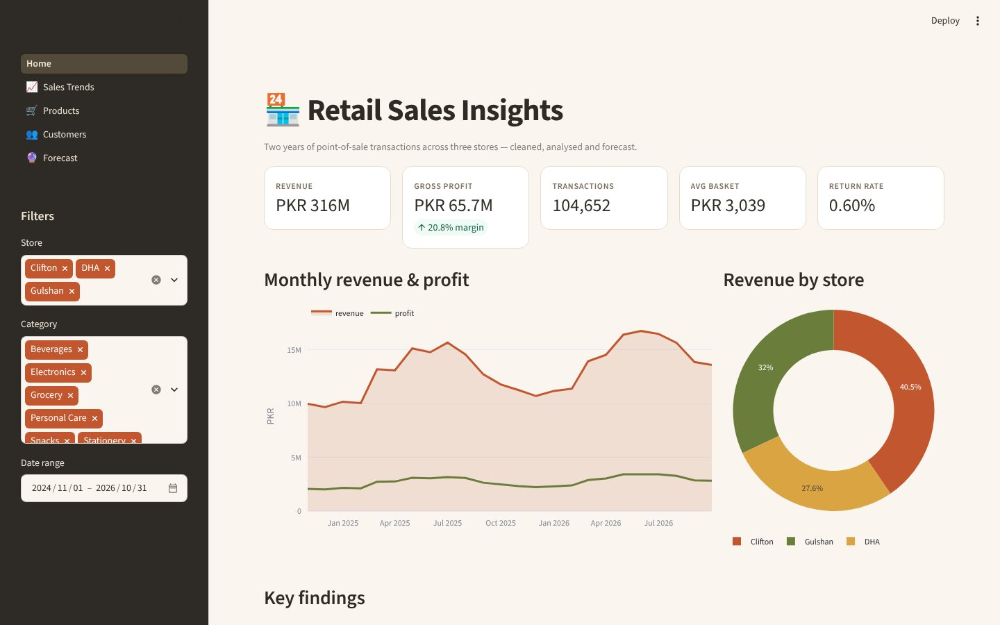
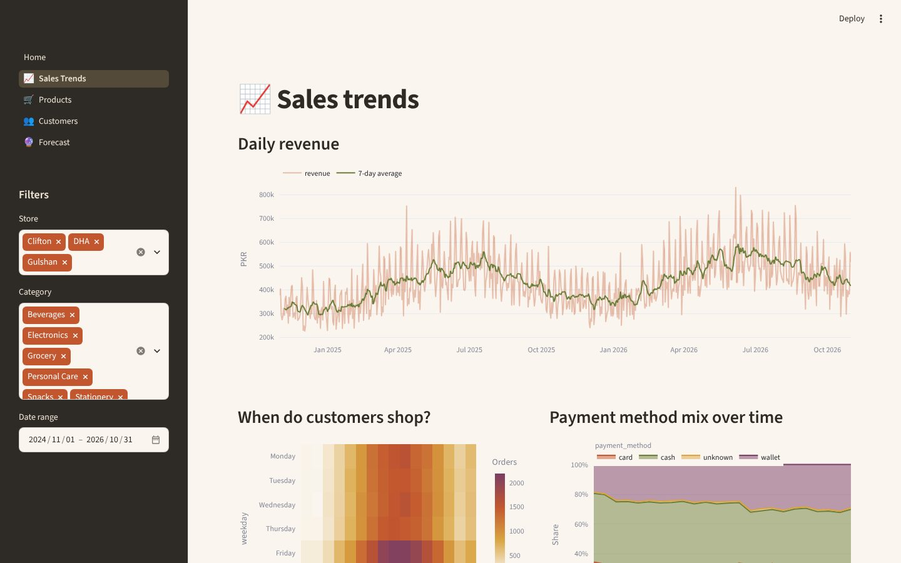
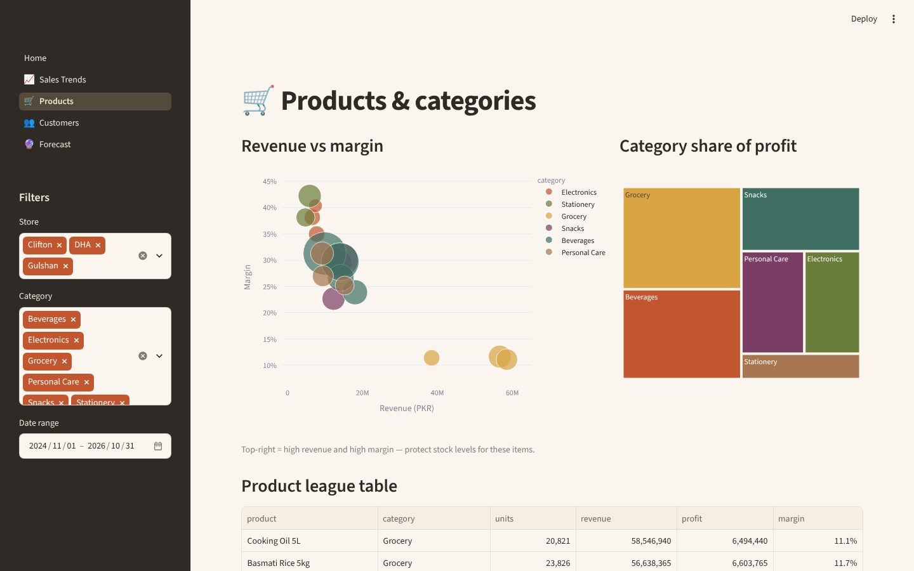
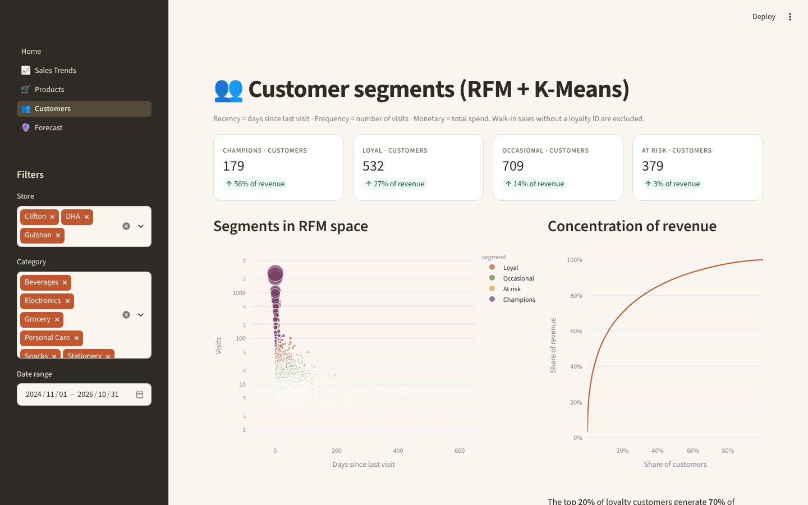
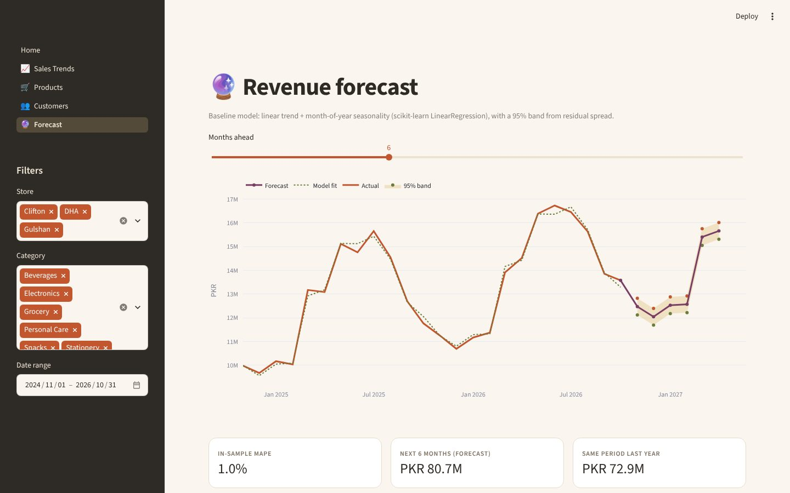

<div align="center">

# 🟫 Retail Sales Insights — Data Analysis & Forecasting

**Cleaning, analysing, segmenting and forecasting 260k point-of-sale records — as a notebook and a multi-page Streamlit dashboard.**




</div>

---

## 📌 Business questions

1. How is revenue trending, and how seasonal is it?
2. When do customers shop — and are we staffed for it?
3. Which products and categories make money (not just revenue)?
4. Who are our most valuable customers, and who are we losing?
5. What revenue should we plan for over the next 6 months?

## 🔍 Approach

| Step | What I did |
|---|---|
| **Data** | `data/generate_data.py` simulates 2 years × 3 stores of POS line items with trend, weekly and yearly seasonality, a Ramadan demand spike, Pareto-distributed customers and a shift from cash to wallets |
| **Quality audit** | Found and fixed duplicate rows, returns recorded as negative quantities, inconsistent store casing, missing payment methods |
| **EDA** | Monthly revenue & profit, weekday × hour heat map, payment-mix shift, store comparison |
| **Products** | Revenue vs margin scatter, category profit share, product league table, **restock planner** (units for N days of cover) |
| **Customers** | **RFM** (recency, frequency, monetary) → log-scaled → **K-Means** (k=4) → named segments; revenue concentration curve |
| **Forecast** | Linear trend + month-of-year dummies (scikit-learn) with a 95% band from residual spread — a transparent baseline |

## 💡 Key findings (from the notebook)

- Average monthly revenue in the latest 3 months is **+44%** vs the first 3 months (underlying growth plus a strong yearly cycle).
- **Friday & Saturday 5–8 pm** is the peak — the clearest case for an extra cashier.
- Grocery is ~half of revenue but earns only an **~11% margin**; Stationery (**~40%**) and Electronics accessories (**~38%**) are the most profitable per sale.
- *Champions* are **~10% of loyalty customers but ~56% of identified revenue**; the *At risk* segment is 21% of customers.
- Wallet payments rose from **19% → 30%** of revenue while cash fell from 46% → 37%.

## 📸 Dashboard pages

| Sales trends | Products |
|---|---|
|  |  |
| **Customers (RFM)** | **Forecast** |
|  |  |

All pages share sidebar filters for **store, category and date range**.

## 🚀 Run it

```bash
pip install -r requirements.txt
python data/generate_data.py               # creates data/sales.csv (~23 MB, not committed)
streamlit run app/Home.py                  # dashboard at http://localhost:8501
jupyter notebook notebooks/01_retail_sales_analysis.ipynb
```

> The app generates the dataset automatically if `data/sales.csv` is missing, so it also deploys straight to **Streamlit Community Cloud** (main file: `app/Home.py`).

## 🗂 Structure

```
data/generate_data.py        reproducible synthetic dataset
src/analysis.py              cleaning, KPIs, RFM + K-Means, forecast, restock planner (shared)
notebooks/                   full analysis with charts & recommendations
app/Home.py                  Streamlit entry
app/pages/                   Sales Trends · Products · Customers · Forecast
.streamlit/config.toml       earthy theme
```

## 🛣 Next steps

- Back-test the forecast on a holdout period; compare with SARIMA / Prophet
- Market-basket analysis (association rules) for bundle recommendations
- Connect to the live [Biltax POS](https://github.com/YOUR-USERNAME/biltax-inventory-pos) database

## 👩‍💻 Author

**Azka Abdul Ghafoor** — MS Data Science (FAST-NUCES, in progress) · 📧 aazka4473@gmail.com

<sub>Data is synthetic and generated for this project. MIT licensed.</sub>
